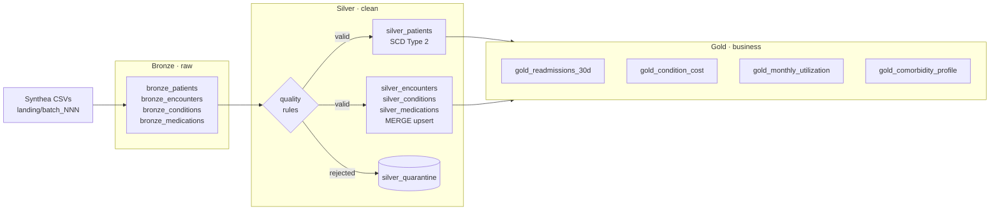

# Healthcare Lakehouse · PySpark + Delta Lake

A batch data pipeline that turns raw patient records into analytics tables, using
**PySpark**, **Delta Lake** and the **medallion architecture** (bronze → silver → gold).
The same code runs in three places:

| Where | Storage | Orchestration |
|---|---|---|
| Laptop, plain Python | local folders | `make run-local` |
| Docker Compose | **MinIO** (S3-compatible object storage) | **Apache Airflow** DAG |
| **Databricks Free Edition** | **Unity Catalog** managed Delta tables | **Databricks Workflows** (Asset Bundle) |

It is the batch counterpart to my streaming project
[realtime-health-analytics](https://github.com/prajwal-jadhav01/realtime-health-analytics)
(Kafka → Flink → Pinot).

The data is **synthetic** ([Synthea](https://github.com/synthetichealth/synthea)): realistic
patients, encounters, diagnoses and prescriptions, but no real people.



## What each layer does

**Bronze**: load each batch of CSVs as-is into Delta tables.
- Every column stays a **string**, so nothing is lost if a value is malformed.
- Lineage columns are added: `_batch_id`, `_source_file` (from Spark's hidden `_metadata` column) and `_ingested_at`.
- Writes use `replaceWhere _batch_id = '…'`, so **re-running a batch never duplicates rows**.
- `mergeSchema` lets a new source column flow in without breaking the job (schema evolution).

**Silver**: clean, typed, de-identified tables.
- **Data quality rules** (`quality.py`). Each rule is a named Spark `Column` condition. Rows that fail go to
  `silver_quarantine`, with the list of rules they broke and the raw record as JSON.
  If more than 10% of a batch is rejected, the job **fails** instead of loading bad data.
- **De-identification** loosely follows HIPAA Safe Harbor:
  - names, SSN, licence/passport numbers, street address and lat/lon are dropped
  - patient IDs become a **salted SHA-256** `patient_key`, so tables still join
  - only the birth *year* is kept (and none at all for people aged 90 or over)
  - only the first 3 digits of the ZIP code are kept
- **SCD Type 2** on patients: when an address, marital status or income changes, the old row is closed
  (`effective_to`, `is_current = false`) and a new version is inserted. This is done in one Delta `MERGE`
  using the "staged union" trick (see `scd2_merge_patients`).
- **Upserts** for encounters, conditions and medications: `MERGE` on the business key.
  A row-hash check skips rows that haven't changed, so **re-running a batch makes no new Delta commit**.
- **Deletion vectors** are on: a `MERGE` that corrects 1,396 encounters marks the old rows as deleted
  instead of rewriting the whole Parquet file (0 rows copied, according to Delta's own metrics).

**Gold**: tables an analyst or dashboard reads directly. Two are built with the DataFrame API and two with Spark SQL.
- `gold_readmissions_30d`: 30-day readmission rate per month (window function `lead()` per patient).
- `gold_condition_cost`: total cost of care per condition, adding encounter cost and medication cost.
- `gold_monthly_utilization`: encounters, unique patients and cost per month and encounter type (SQL).
- `gold_comorbidity_profile`: how cost and visits grow with the number of chronic conditions (SQL, CTEs).

**Maintenance**: `OPTIMIZE … ZORDER BY (patient_key)` compacts the small files that MERGEs leave behind.
`VACUUM` keeps Delta's 7-day default, which is what keeps **time travel** working.

## Results on the sample data (1,000 Synthea patients, seed 42)

Your numbers will be a few percent different: Synthea simulates up to today's date, so each run differs slightly.

| | rows |
|---|---|
| patients / encounters / conditions / medications (batch_001) | 1,145 / 69,809 / 42,136 / 60,117 |
| batch_002: changed patients → new SCD2 versions | 57 |
| batch_002: corrected encounter costs merged | 1,396 |
| batch_002: rows sent to quarantine | 5 (3 patients, 2 encounters) |
| re-run of an already-loaded batch | 0 new commits |

`gold_comorbidity_profile` shows the pattern you'd expect from real data: patients with 3 or more chronic
conditions have nearly 5x the lifetime healthcare expenses of patients with none, and about 4.5x as many encounters.

## Run it

### 1. Generate data (needs Docker)
```bash
make data        # Synthea → data/landing/batch_001, then derives batch_002 (changes + bad rows)
```

### 2a. Locally, no Docker (Python 3.10–3.13, Java 17 or 21)
```bash
make venv
make run-local   # batch_001 then batch_002 through every layer, about 2 minutes
make report      # row counts, SCD2 history, quarantine, gold tables, Delta history
make test        # 11 unit tests on a local SparkSession
```

### 2b. Docker: MinIO + Airflow
```bash
make up                          # builds the image, starts MinIO, uploads landing data, starts Airflow
make airflow-run BATCH=batch_001
make airflow-run BATCH=batch_002
docker compose exec airflow python -m lakehouse.jobs.report
```
- Airflow UI: http://localhost:8080. The user is `admin`; get the password with
  `docker compose exec airflow cat /opt/airflow/standalone_admin_password.txt`
- MinIO console: http://localhost:9001 (`lakehouse` / `lakehouse-secret`). Browse `lakehouse/lake/` to see the
  Parquet files and `_delta_log/` of every table.
- After regenerating data, run `make minio-sync` to upload it again.

### 2c. Databricks Free Edition
1. Sign up at [databricks.com/learn/free-edition](https://www.databricks.com/learn/free-edition). It's free and needs no card.
2. Install the [Databricks CLI](https://docs.databricks.com/dev-tools/cli/install.html), then run
   `databricks auth login --host <your workspace URL>`.
3. `make bundle-deploy`. This uploads the code and creates the job **healthcare-lakehouse-pipeline**.
4. In the workspace, open `databricks/notebooks/00_setup` and run it. It creates the schema and a **volume**.
   Then upload the CSVs:
   `databricks fs cp -r data/landing dbfs:/Volumes/workspace/lakehouse/landing`
5. `make bundle-run BATCH=batch_001`, then `make bundle-run BATCH=batch_002`.
6. Open `databricks/notebooks/02_explore` for the demo queries, including time travel with `VERSION AS OF`.

No CLI? Use **Workspace → Create → Git folder**, paste this repo's URL, and run the `run_layer` notebook
with the widgets `layer = all` and `batch_id = batch_001`.

## Project layout
```
src/lakehouse/
  config.py        env-driven settings (path vs Unity Catalog, S3 endpoint, salt, DQ threshold)
  spark.py         SparkSession with Delta (+ S3A for MinIO); reuses the session on Databricks
  tables.py        TableStore: read/write/merge by logical name, wherever the table lives
  bronze.py        raw CSV → Delta, lineage columns, idempotent batch loads
  quality.py       rule engine, quarantine, reject-ratio gate
  silver.py        typing, de-identification, SCD2 MERGE, upserts
  gold.py          4 business tables (DataFrame API + Spark SQL)
  maintenance.py   OPTIMIZE / ZORDER
  jobs/run.py      CLI used by Makefile, Airflow and Databricks
  jobs/report.py   prints what's in the lakehouse
airflow/dags/      bronze → silver → gold → optimize DAG
databricks/        notebooks for Databricks (+ databricks.yml at the root)
docker/            Airflow + Java + PySpark image
scripts/           Synthea data generation, batch_002 builder
tests/             pytest on a local SparkSession
docs/WALKTHROUGH.md  how to explain every design decision
```

## Honest limits, and what I'd do next
- It's single-node Spark (local mode, or Free Edition serverless). The data is around 100K rows, not terabytes.
  The patterns (partition-aware writes, MERGE, OPTIMIZE) are the same at scale, but I haven't tuned a big cluster with this project.
- MinIO is S3-*compatible*. Pointing it at real AWS S3 means changing `S3_ENDPOINT` and the keys.
  Swapping MinIO for ADLS Gen2 on Azure would be a config change in `spark.py` (`abfss://`).
- Gold is fully rebuilt each run. That is cheap at this size; at scale I'd make it incremental using Delta Change Data Feed.
- On Databricks I'd move to **Auto Loader** for ingestion, **Lakeflow Declarative Pipelines expectations**
  instead of the hand-rolled quality rules, **liquid clustering** instead of Z-ORDER, and Unity Catalog
  column masks for PHI.
